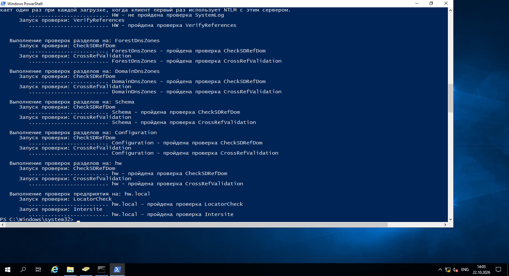

# Домашнее задание к занятию «Active Directory. Часть 2»

---

## Задание 1

Проведите самостоятельный аудит установленного на прошлом занятии DC, опираясь на лекцию. 

Проведете проверку системы при помощи [DCDiag.](https://learn.microsoft.com/ru-ru/windows-server/administration/windows-commands/dcdiag)

*Дайте ответ в свободной форме.*

---

#### Результаты проверок

**Успешно пройденные тесты:**

- **Connectivity** - контроллер доступен по сети, имя разрешается по DNS, порты LDAP и RPC отвечают.
- **Advertising** - контроллер объявляет свои роли в домене, службы KDC и LDAP функционируют.
- **FrsEvent** - ошибок FRS нет (используется служба репликации DFSR).
- **SysVolCheck** - каталоги SYSVOL и NetLogon открыты для общего доступа и доступны.
- **KccEvent** - ошибок топологии репликации KCC не зафиксировано.
- **KnowsOfRoleHolders** - все 5 FSMO-ролей определены и доступны на контроллере домена.
- **MachineAccount** - учетная запись компьютера в AD и SPN-имена в порядке.
- **NCSecDesc** - дескрипторы безопасности разделов каталога корректны.
- **NetLogons** - разрешения на вход в сеть и безопасный канал аутентификации в норме.
- **ObjectsReplicated** - базовые системные объекты AD реплицированы.
- **Replications** - репликация каталога завершается без ошибок.
- **RidManager** - пул относительных идентификаторов (RID) выдается корректно.
- **Services** - ключевые службы Active Directory (NTDS, DNS, KDC, Netlogon) запущены и работают.
- **VerifyReferences** - перекрестные ссылки между разделами каталога согласованы.
- **ForestDnsZones / DomainDnsZones / Schema / Configuration / hw** - разделы DNS и контексты именования каталога валидны.
- **LocatorCheck / Intersite** - поиск DC на уровне предприятия и межсайтовая связность подтверждены.

---

**Тесты с замечаниями и ошибками в журналах:**

- **DFSREvent** - зафиксированы события в журнале репликации DFS:
  - *Event ID 0xC00004B2* - кратковременная задержка связи при старте службы до полной инициализации сети.
  - *Event ID 0x800008A4* - автоматическое восстановление базы DFSR после некорректного выключения виртуальной машины. Каталог SYSVOL полностью исправен и доступен (тест SysVolCheck пройден).
- **SystemLog** - зафиксированы системные предупреждения и ошибки:
  - *Завершение работы (Event ID 0x80001778, 0x00000029)* - фиксация внезапного выключения виртуальной машины без корректного завершения работы ОС.
  - *DNS-клиент (Event ID 0x000003F6)* - кратковременный таймаут разрешения имени в первые секунды загрузки ОС до старта локальной службы DNS.
  - *Служба времени W32Time (Event ID 0x0000000C)* - PDC-эмулятор в корне леса не имеет внешнего источника времени (стандартно для изолированного учебного стенда).
  - *DCOM (Event ID 0x00002720)* - локальные разрешения активации COM-сервера для сетевой службы (типовая системная запись Windows, не влияющая на работу AD).
  - *NTLM (Event ID 0x00001796)* - информационное предупреждение об использовании проверки подлинности NTLM клиентом.

---

#### Итог

Контроллер домена `hw.local` находится в полностью рабочем состоянии. Службы каталога AD DS функционируют исправно, FSMO-роли доступны, каталог SYSVOL опубликован, репликация и DNS работают штатно. Зафиксированные ошибки в журналах связаны с некорректным завершением работы учебной виртуальной машины и изолированностью лабораторной сети от интернета, на функционирование Active Directory они не влияют.
